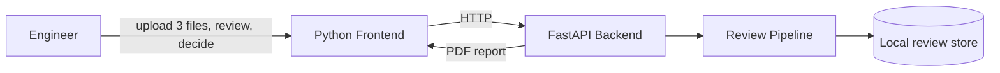
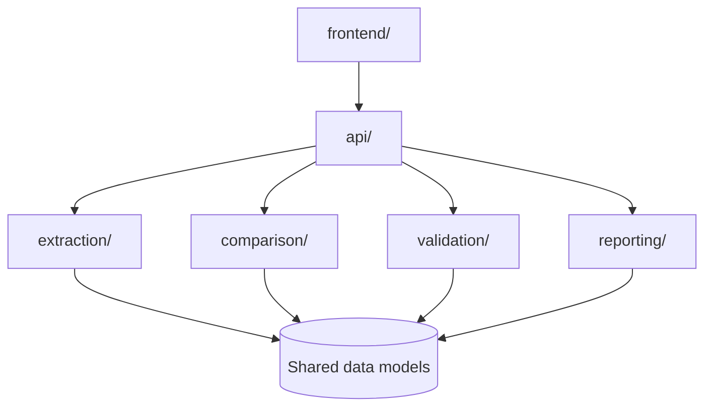
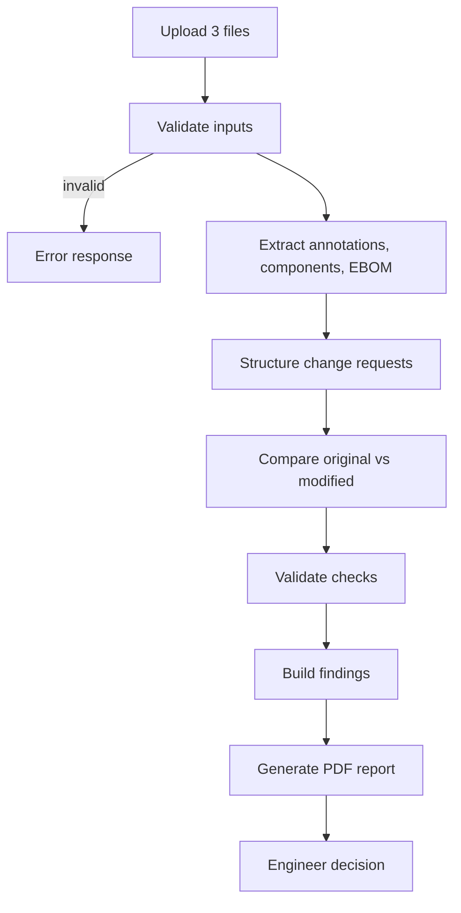
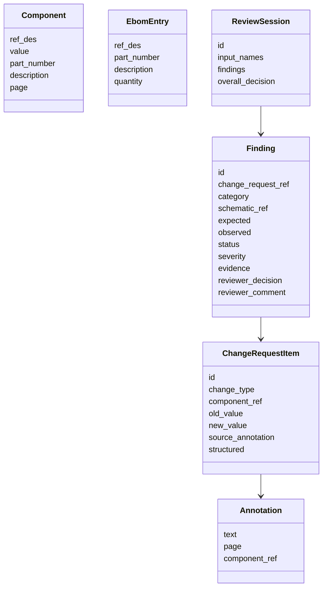

# Architecture Design: Schematic Change Review MVP

Source requirements: [SRS](../automotive_schematic_change_review_mvp_srs.md). Project rules: [AGENTS.md](../../AGENTS.md).

This is a demo MVP. All results are advisory until an engineer approves or rejects them.

## 1. Goals and constraints

- Review a modified Zuken schematic PDF against an annotated original PDF and an EBOM (XLSX).
- Produce an evidence-based PDF report with traceable findings.
- Extraction and validation are deterministic. No AI interpretation of ambiguous comments.
- Every check is `Pass`, `Fail` or `Unable to Verify`. Missing or unextractable data is never a pass.
- Connectivity is `Unable to Verify` unless structured netlist data is supplied (assumed unavailable by default).
- Engineering documents are confidential. Document contents and extracted data are not logged.
- Single-host local run (uvicorn). No performance, file-size, concurrency or retention targets are defined.

## 2. System context

Inputs: original annotated PDF, modified PDF, EBOM XLSX. Output: review session with findings, a PDF report and the engineer decision.

## 3. Module structure

| Module | Responsibility | Libraries |
|---|---|---|
| `api/` | Routes, upload handling, input validation, review session endpoints, decision recording. | FastAPI |
| `extraction/` | PDF annotations (with page refs), schematic text and component data, EBOM parsing. | PyMuPDF, openpyxl |
| `comparison/` | Layout-independent diff of original vs modified component sets. | stdlib |
| `validation/` | Requested-change, unintended-change, EBOM and connectivity checks. | stdlib |
| `reporting/` | Finding aggregation, summary counts, PDF report generation. | PyMuPDF or a PDF library chosen at implementation |
| `frontend/` | Upload form, findings view, approve/reject/investigate actions, report download. | Python web UI |
| `tests/` | pytest unit tests on a small sanitized dataset. | pytest |

Modules depend only on the shared data models, not on each other, so each can be tested independently (NFR-01). The pipeline orchestrator in `api/` wires them together.

## 4. Processing pipeline

1. **Input validation**: all three files present, correct type, readable, not password-protected. Report annotation and EBOM field availability. Errors are returned clearly and never swallowed.
2. **Extraction**: produce `Annotation`, `Component` and `EbomEntry` records, each carrying source document and page.
3. **Change request structuring**: map explicit annotations to structured `ChangeRequestItem`s (add, remove, replace, value change, part-number change). Annotations that cannot be mapped deterministically are marked `Unable to Verify` and flagged for engineer clarification. Intent is not inferred.
4. **Comparison**: diff components keyed by reference designator, independent of page, position or page count.
5. **Validation**: run the check groups below.
6. **Reporting**: aggregate findings, produce the PDF report.
7. **Decision**: the engineer records Approved, Rejected or Requires Investigation per finding and for the overall review.

## 5. Validation checks

| Check | Input | Outcome rules |
|---|---|---|
| Requested change | `ChangeRequestItem` + modified components | `Pass` if modified state matches the request, `Fail` if missing or incorrect, `Unable to Verify` if the item is unstructured or data is missing. |
| Unintended change | Component diff minus requested changes | Any added, removed or modified component not covered by a request is a finding (`Fail`). Layout-only changes are ignored. |
| EBOM reconciliation | Modified components + EBOM entries | Compare by reference designator: presence, part number, description, quantity. Mismatch is `Fail`. Missing fields are `Unable to Verify`. |
| Connectivity | Optional structured netlist | `Unable to Verify` without netlist data. Visual PDF comparison is never treated as connectivity verification. |

Checks are pure functions over the data models, which keeps results identical for identical inputs (NFR-08).

## 6. Data model

- `status`: `Pass` | `Fail` | `Unable to Verify`.
- `category`: component, value, part number, EBOM, connectivity, unintended change.
- `reviewer_decision`: `Pending` | `Approved` | `Rejected` | `Requires Investigation` (default `Pending`).
- Models are defined once (for example as Pydantic or dataclasses) and shared across modules.

## 7. API surface

| Method | Path | Purpose |
|---|---|---|
| POST | `/reviews` | Upload original PDF, modified PDF, EBOM. Validates, runs the pipeline, returns the review ID and findings. |
| GET | `/reviews/{id}` | Review summary and findings. |
| PUT | `/reviews/{id}/changes/{item_id}` | Engineer clarifies or structures an ambiguous change request item, then re-runs validation. |
| PUT | `/reviews/{id}/findings/{finding_id}/decision` | Record the reviewer decision and comment. |
| PUT | `/reviews/{id}/decision` | Record the overall approval or rejection. |
| GET | `/reviews/{id}/report` | Download the PDF report. |

Paths are a proposal and may be adjusted during implementation.

## 8. Traceability and error handling

- Every `Finding` references its change request item, source document and page (NFR-03).
- Extraction failures become explicit `Unable to Verify` findings or input errors, not silent skips (NFR-06).
- Error responses use clear messages for missing, unsupported, unreadable or password-protected files (NFR-02).

## 9. Security and data handling

- Uploaded files and extracted data stay on the local host in a per-review working directory.
- Do not log file contents, annotation text or extracted component data. Log only IDs, statuses and error types.
- Validate file type and content on upload. Use server-generated file names, never client-supplied paths.
- No real engineering files in the repo. Tests use sanitized samples.
- Access control beyond local single-host use is out of scope for the MVP (NFR-07 is addressed by local-only operation).

## 10. Persistence

Review sessions (findings and decisions) are held in a simple local store (JSON files per review ID or in-memory for the demo). No retention period is defined. A real database is a future enhancement.

## 11. Testing approach

- pytest with a small controlled dataset and known expected outcomes.
- Cases: valid inputs; missing or unsupported files; requested change implemented; requested change missing or incorrect; unintended modification; page layout change only; EBOM match and mismatch; connectivity `Unable to Verify`.
- Each module is tested in isolation using the shared models as fixtures.
- Lint and format: `ruff check` and `ruff format --check`.

## 12. Deployment

Single-host local run: `uvicorn` serving the FastAPI app, with the Python frontend running alongside it.

## 13. Open items and future work

- Structured Zuken netlist import to enable real connectivity checks.
- Exact EBOM column names and worksheet layout (defaults: reference designator, part number, description, quantity).
- Supported PDF annotation types (default: text/comment annotations with page reference).
- AI-assisted interpretation of ambiguous comments with engineer confirmation.
- Role-based access, audit history, PLM integration.
