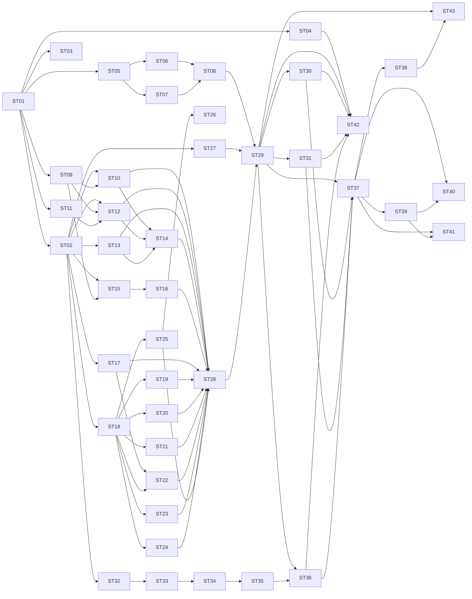

# Backlog: Schematic Change Review MVP

Source: [SRS](automotive_schematic_change_review_mvp_srs.md), [Architecture](design/architecture.md), [AGENTS.md](../AGENTS.md).

## 1. Conventions

**Sizing** uses estimated production lines of code (LOC). Tests, test fixtures, docs, blank lines, comments and imports are excluded.

| Size | Estimated LOC | Rule |
|---|---|---|
| S | up to 30 | Single function or endpoint. |
| M | 31 to 60 | A small module. |
| L | 61 to 100 | Hard cap. Anything larger must be split. |

Estimates are planning aids, not commitments.

**Story rules**

- Independently testable: each story has its own tests and runs without any later story. Dependencies are limited to earlier stories (or shared models/fixtures).
- Logically complete: each story delivers one working behaviour, not a half-finished layer.
- Every check outcome is `Pass`, `Fail` or `Unable to Verify`. Missing or unextractable data is never `Pass`.
- Extraction and validation are deterministic. No AI interpretation. No logging of document content.
- Subtasks (`T1`, `T2`, ...) are implementation steps inside one story. They are not separately deliverable.

**Priority**: Must, Should, Could (from SRS priority and acceptance criteria).

## 2. Assumptions

These are defaults from the architecture. They are not confirmed business decisions.

| # | Assumption | Used by |
|---|---|---|
| A1 | Annotations are PDF Text/FreeText annotations with non-empty content. | ST-10 |
| A2 | Reference designator pattern: 1 to 3 capital letters followed by digits (`R101`, `C201`, `U101`). | ST-09 |
| A3 | A schematic component is a text block whose first line is a reference designator. Following lines hold value, optional `PN: <part number>` and optional description. Must be confirmed against a real Zuken export. | ST-12 |
| A4 | EBOM columns: reference designator, part number, description, quantity. One reference designator per row. Header matching is case and whitespace insensitive. | ST-07, ST-13 |
| A5 | Explicit change request grammar is limited to the patterns in ST-15 and ST-16. Everything else is unstructured. | ST-15, ST-16 |
| A6 | Severity has no agreed rules, so it stays `None`. | ST-02, ST-18 |
| A7 | No netlist is supplied by default. Connectivity is `Unable to Verify`. | ST-25 |
| A8 | Review state is stored as JSON files per review ID. | ST-27 |
| A9 | Frontend framework is Streamlit (proposal, recorded in ST-38). | ST-37 to ST-41 |

## 3. Story summary

| ID | Title | Size | Est. LOC | Priority | Depends on |
|---|---|---|---|---|---|
| ST-01 | Project scaffold and tooling | S | 15 | Must | none |
| ST-02 | Shared data models | M | 55 | Must | ST-01 |
| ST-03 | Confidentiality-safe logging | S | 20 | Must | ST-01 |
| ST-04 | Sanitized sample dataset builders | M | tests only | Must | ST-01 |
| ST-05 | Input error model and handler | S | 25 | Must | ST-01 |
| ST-06 | PDF input check | S | 25 | Must | ST-05 |
| ST-07 | EBOM XLSX input check | S | 20 | Must | ST-05 |
| ST-08 | Upload storage service | M | 45 | Must | ST-06, ST-07 |
| ST-09 | Reference designator parser | S | 15 | Must | ST-01 |
| ST-10 | PDF annotation extraction | M | 45 | Must | ST-02, ST-09 |
| ST-11 | PDF text block extraction | S | 25 | Must | ST-01 |
| ST-12 | Schematic component assembly | L | 75 | Must | ST-02, ST-09, ST-11 |
| ST-13 | EBOM parser | M | 55 | Must | ST-02 |
| ST-14 | Extraction capability report | S | 25 | Should | ST-10, ST-12, ST-13 |
| ST-15 | Change request structuring: value, part number, replace | M | 50 | Must | ST-02, ST-09 |
| ST-16 | Change request structuring: add, remove, fallback | S | 30 | Must | ST-15 |
| ST-17 | Component diff | M | 40 | Must | ST-02 |
| ST-18 | Finding builder | S | 25 | Must | ST-02 |
| ST-19 | Requested-change check: add and remove | S | 25 | Must | ST-18 |
| ST-20 | Requested-change check: value, part number, replace | M | 45 | Must | ST-18 |
| ST-21 | Unstructured request finding | S | 15 | Must | ST-18 |
| ST-22 | Unintended-change check | M | 50 | Must | ST-17, ST-18 |
| ST-23 | EBOM reconciliation per reference | M | 50 | Must | ST-18 |
| ST-24 | EBOM quantity reconciliation | S | 25 | Must | ST-18 |
| ST-25 | Connectivity check: Unable to Verify | S | 25 | Must | ST-18 |
| ST-26 | Connectivity check from structured netlist | M | 55 | Could | ST-18, ST-25 |
| ST-27 | Review store | S | 30 | Must | ST-02 |
| ST-28 | Review pipeline orchestrator | M | 55 | Must | ST-10, ST-12, ST-13, ST-14, ST-16, ST-17, ST-19 to ST-25 |
| ST-29 | Create and read review endpoints | M | 45 | Must | ST-08, ST-27, ST-28 |
| ST-30 | Change request clarification endpoint | M | 40 | Must | ST-29 |
| ST-31 | Decision endpoints | M | 40 | Must | ST-29 |
| ST-32 | Findings summary | S | 15 | Must | ST-02 |
| ST-33 | PDF report: writer, header and summary | M | 50 | Must | ST-32 |
| ST-34 | PDF report: findings sections | L | 70 | Must | ST-33 |
| ST-35 | PDF report: decision and limitations | S | 25 | Must | ST-34 |
| ST-36 | Report download endpoint | S | 20 | Must | ST-29, ST-35 |
| ST-37 | Frontend API client | M | 40 | Must | ST-29, ST-30, ST-31, ST-36 |
| ST-38 | Frontend upload page | M | 50 | Must | ST-37 |
| ST-39 | Frontend findings view | M | 55 | Must | ST-37 |
| ST-40 | Frontend decisions and clarification | M | 55 | Must | ST-37, ST-39 |
| ST-41 | Frontend report download | S | 15 | Must | ST-37, ST-39 |
| ST-42 | End-to-end acceptance tests | M | tests only | Must | ST-04, ST-29, ST-30, ST-31, ST-36 |
| ST-43 | README and run guide | S | docs only | Should | ST-29, ST-38 |

Totals: 43 stories (20 S, 21 M, 2 L). No story exceeds 100 production LOC.

## 4. Dependency graph

## 5. Build waves

Stories in the same wave have no dependency on each other and can be built in parallel. A story can start once all its dependencies are done.

| Wave | Stories |
|---|---|
| 0 | ST-01 |
| 1 | ST-02, ST-03, ST-04, ST-05, ST-09, ST-11 |
| 2 | ST-06, ST-07, ST-10, ST-12, ST-13, ST-15, ST-17, ST-18, ST-27, ST-32 |
| 3 | ST-08, ST-14, ST-16, ST-19, ST-20, ST-21, ST-22, ST-23, ST-24, ST-25, ST-33 |
| 4 | ST-26, ST-28, ST-34 |
| 5 | ST-29, ST-35 |
| 6 | ST-30, ST-31, ST-36 |
| 7 | ST-37, ST-42 |
| 8 | ST-38, ST-39 |
| 9 | ST-40, ST-41, ST-43 |

Critical path: ST-01, ST-02, ST-12, ST-14, ST-28, ST-29, ST-36, ST-37, ST-39, ST-40.

## 6. Acceptance criteria coverage

| SRS acceptance criterion | Stories |
|---|---|
| 1. Upload all three files | ST-08, ST-29, ST-38 |
| 2. Extract annotations | ST-10, ST-14 |
| 3. Parse EBOM and map by reference designator | ST-13, ST-23 |
| 4. Requested change identified as implemented | ST-19, ST-20, ST-42 |
| 5. Requested change identified as missing or incorrect | ST-19, ST-20, ST-42 |
| 6. Unintended modification identified | ST-17, ST-22, ST-42 |
| 7. EBOM reconciliation | ST-23, ST-24 |
| 8. Connectivity result or Unable to Verify | ST-25, ST-26 |
| 9. Report with traceable evidence | ST-33 to ST-36 |
| 10. Engineer approval or rejection | ST-31, ST-40 |

---

## 7. Epic E1: Foundation

### ST-01 Project scaffold and tooling

- **Size**: S (about 15 LOC). **Priority**: Must. **Depends on**: none.
- **Scope**: Python project with the module layout from the architecture and a runnable FastAPI app.
- **Subtasks**
  - T1: `pyproject.toml` with FastAPI, uvicorn, PyMuPDF, openpyxl, httpx, pytest, ruff.
  - T2: Packages `api/`, `extraction/`, `comparison/`, `validation/`, `reporting/`, `frontend/`, `tests/`.
  - T3: `api/main.py` with `GET /health`.
  - T4: ruff and pytest configuration.
- **Acceptance**
  - `uvicorn api.main:app` starts and `GET /health` returns 200.
  - `ruff check`, `ruff format --check` and `pytest` pass on a clean checkout.
- **Tests**: health endpoint test using `TestClient`.

### ST-02 Shared data models

- **Size**: M (about 55 LOC). **Priority**: Must. **Depends on**: ST-01.
- **Traces**: NFR-01, NFR-03, NFR-04, SRS section 6.
- **Scope**: Pydantic v2 models and enums shared by all modules, in one module.
- **Subtasks**
  - T1: Enums `Status` (Pass, Fail, Unable to Verify), `Category`, `ChangeType` (add, remove, replace, value change, part-number change), `Decision` (Pending, Approved, Rejected, Requires Investigation).
  - T2: `Annotation`, `ChangeRequestItem`, `Component`, `EbomEntry`.
  - T3: `Finding` with `severity` optional and default `None` (A6), `reviewer_decision` default `Pending`.
  - T4: `ReviewSession` with `input_names`, `change_items`, `findings`, `overall_decision`.
- **Acceptance**
  - Enum values match the SRS wording exactly.
  - `Finding` defaults: decision `Pending`, severity `None`, comment `None`.
  - Every model serializes to JSON and back without loss.
- **Tests**: defaults, enum values, JSON round trip.

### ST-03 Confidentiality-safe logging

- **Size**: S (about 20 LOC). **Priority**: Must. **Depends on**: ST-01.
- **Traces**: NFR-07, architecture section 9.
- **Scope**: A single `log_event` helper. Only allow-listed keys (`review_id`, `finding_id`, `status`, `error_type`).
- **Subtasks**
  - T1: `log_event(event, **fields)` that raises `ValueError` on any non-allowed key.
  - T2: Standard logger configuration.
- **Acceptance**: Passing `text=` or any content field is rejected. Allowed keys appear in the log record.
- **Tests**: `caplog` test for allowed keys and rejection.

### ST-04 Sanitized sample dataset builders

- **Size**: M (test code only, excluded from the LOC cap). **Priority**: Must. **Depends on**: ST-01.
- **Traces**: SRS section 10, AGENTS.md testing rules.
- **Scope**: Test helpers that generate a small sanitized dataset with PyMuPDF and openpyxl, plus a manifest of expected outcomes. No real engineering files.
- **Subtasks**
  - T1: Original PDF with annotations: `Replace R101 from 10K to 4.7K`, `Replace R102 from 1K to 2.2K`, `Add C301 100nF`, `Remove R103`, and one descriptive comment (`Improve filtering on input stage`).
  - T2: Modified PDF: R101 changed (implemented), R102 unchanged (missing), C301 added, R103 removed, C201 changed 100nF to 220nF (unintended).
  - T3: Variant with components moved to different pages (layout-only change, no other difference).
  - T4: EBOM XLSX matching the modified schematic, and a mismatch variant (wrong part number, missing reference, wrong quantity).
  - T5: Expected-outcome manifest constants.
  - T6: Variants for invalid inputs: password-protected PDF, non-PDF file, EBOM with missing column.
- **Acceptance**: Builders are deterministic. Each variant can be created in a temp directory by a pytest fixture.
- **Tests**: Sanity test that the generated files open and contain the expected annotations and text.

---

## 8. Epic E2: Input intake

### ST-05 Input error model and handler

- **Size**: S (about 25 LOC). **Priority**: Must. **Depends on**: ST-01.
- **Traces**: NFR-02, NFR-06.
- **Scope**: `InputError` with `code`, `message`, `file_role`, and a FastAPI handler returning HTTP 422 with a list of errors.
- **Subtasks**
  - T1: Codes `MISSING_FILE`, `UNSUPPORTED_TYPE`, `UNREADABLE`, `PASSWORD_PROTECTED`, `EMPTY_FILE`.
  - T2: `InputErrors` aggregate so several errors are reported together.
  - T3: Exception handler.
- **Acceptance**: Messages never include file contents. Response body is `{"errors": [{code, message, file_role}]}`.
- **Tests**: handler response shape through a throwaway route.

### ST-06 PDF input check

- **Size**: S (about 25 LOC). **Priority**: Must. **Depends on**: ST-05.
- **Traces**: FR-01, FR-02, SRS section 4.2.
- **Scope**: `check_pdf(path, role)` raising `InputError`.
- **Subtasks**
  - T1: Detect non-PDF (extension and `%PDF` header).
  - T2: Detect password-protected and unreadable files.
  - T3: Detect PDFs with zero pages.
- **Acceptance**: Valid PDF passes. Each failure maps to the correct error code and `file_role`.
- **Tests**: valid, text file renamed `.pdf`, password-protected, corrupt, empty-page PDF.

### ST-07 EBOM XLSX input check

- **Size**: S (about 20 LOC). **Priority**: Must. **Depends on**: ST-05.
- **Traces**: FR-03, SRS section 4.2.
- **Scope**: `check_ebom(path)` raising `InputError`.
- **Subtasks**
  - T1: Detect non-XLSX (extension and zip signature).
  - T2: Detect unreadable or password-protected workbook.
  - T3: Detect workbook with no data rows.
- **Acceptance**: Valid workbook passes. Each failure maps to the correct code. Column checks are left to ST-13.
- **Tests**: valid, non-XLSX, corrupt, empty workbook.

### ST-08 Upload storage service

- **Size**: M (about 45 LOC). **Priority**: Must. **Depends on**: ST-06, ST-07.
- **Traces**: FR-01 to FR-03, NFR-02, NFR-07, architecture section 9.
- **Scope**: `save_uploads(original, modified, ebom) -> ReviewWorkspace` (review ID and file paths). No HTTP code here.
- **Subtasks**
  - T1: Report all missing files together, not only the first.
  - T2: Generate review ID and server-side file names (`original.pdf`, `modified.pdf`, `ebom.xlsx`) in a per-review directory. Client file names are kept only as display names.
  - T3: Run ST-06 and ST-07 checks and aggregate errors.
  - T4: Remove the directory on failure.
- **Acceptance**
  - Client-supplied names are never used as paths.
  - On any error nothing remains on disk.
  - Base directory is configurable.
- **Tests**: success, each file missing, several errors together, path traversal in the client name, cleanup on failure.

---

## 9. Epic E3: Extraction

### ST-09 Reference designator parser

- **Size**: S (about 15 LOC). **Priority**: Must. **Depends on**: ST-01.
- **Traces**: FR-05, A2.
- **Scope**: `find_ref_des(text) -> list[str]`, ordered, de-duplicated.
- **Acceptance**: `R101`, `C201`, `U101` match. `10K`, `4.7K`, `100nF` do not match. Ordering is stable.
- **Tests**: table-driven cases including multiple references in one string and no match.

### ST-10 PDF annotation extraction

- **Size**: M (about 45 LOC). **Priority**: Must. **Depends on**: ST-02, ST-09.
- **Traces**: FR-04, NFR-03, NFR-06, A1.
- **Scope**: `extract_annotations(path) -> AnnotationExtraction(annotations, ignored_count)`.
- **Subtasks**
  - T1: Read Text and FreeText annotations with PyMuPDF. Page number is 1-based.
  - T2: Set `component_ref` from ST-09 (first match, else `None`).
  - T3: Count annotations that are ignored (empty content or unsupported type) instead of dropping them silently.
  - T4: Deterministic order by page, then annotation order.
- **Acceptance**: Every annotation carries its page. Ignored annotations are counted. A PDF with no annotations returns an empty list without error.
- **Tests**: ST-04 original PDF, PDF without annotations, empty-content annotation, unsupported type.

### ST-11 PDF text block extraction

- **Size**: S (about 25 LOC). **Priority**: Must. **Depends on**: ST-01.
- **Traces**: FR-05.
- **Scope**: `extract_text_blocks(path) -> list[TextBlock]`. `TextBlock` (page, lines) is defined in `extraction/`, not in shared models.
- **Subtasks**
  - T1: Use PyMuPDF block extraction per page.
  - T2: Strip empty lines and sort deterministically (page, then reading order).
- **Acceptance**: Text and page number are preserved. Coordinates are not exposed. No content is logged.
- **Tests**: ST-04 modified PDF yields the expected blocks.

### ST-12 Schematic component assembly

- **Size**: L (about 75 LOC). **Priority**: Must. **Depends on**: ST-02, ST-09, ST-11.
- **Traces**: FR-05, FR-07, NFR-06, A3.
- **Scope**: `build_components(blocks) -> ComponentExtraction(components, unparsed_count, duplicate_refs)`.
- **Subtasks**
  - T1: Identify component blocks (first line is a single reference designator).
  - T2: Parse value, `PN:` part number and description lines.
  - T3: Leave absent fields as `None`. Never fabricate values.
  - T4: Record duplicate reference designators (keep the first, report the rest).
  - T5: Count blocks that look like components but cannot be parsed.
- **Acceptance**
  - Page number is recorded on each component.
  - Moving a component to another page changes only `page`.
  - Unparseable blocks are counted, not discarded.
- **Tests**: full block, value only, missing value, duplicate reference, non-component block, page reorganization.
- **Risk**: A3 must be validated against a real Zuken PDF. If it does not hold, only this story changes.

### ST-13 EBOM parser

- **Size**: M (about 55 LOC). **Priority**: Must. **Depends on**: ST-02.
- **Traces**: FR-06, SRS section 4.2, A4.
- **Scope**: `parse_ebom(path) -> EbomParseResult(entries, missing_columns, row_issues)`.
- **Subtasks**
  - T1: Header detection, case and whitespace insensitive.
  - T2: Map rows to `EbomEntry`.
  - T3: Parse quantity to int. Invalid or empty becomes `None` with a row issue.
  - T4: Report missing columns. Rows without a reference designator become a row issue.
  - T5: Duplicate reference designators become a row issue.
- **Acceptance**: Missing columns are listed, never ignored. Entries are keyed by reference designator.
- **Tests**: valid workbook, missing column, bad quantity, blank reference, duplicate reference.

### ST-14 Extraction capability report

- **Size**: S (about 25 LOC). **Priority**: Should. **Depends on**: ST-10, ST-12, ST-13.
- **Traces**: SRS section 4.2, FR-14, NFR-06.
- **Scope**: `build_extraction_report(...) -> ExtractionReport` with counts and notes: annotations found and ignored, components found, unparsed blocks, EBOM columns present and missing.
- **Acceptance**: Zero annotations or zero components produce an explicit note. Nothing is reported as success when data is missing.
- **Tests**: complete input, no annotations, missing EBOM column, no components.

---

## 10. Epic E4: Change request structuring

Grammar (A5), case insensitive, `<REF>` is a reference designator:

| Pattern | Change type | Fields |
|---|---|---|
| `Replace <REF> from <old> to <new>` | value change | old, new value |
| `Change part number of <REF> from <old> to <new>` | part-number change | old, new part number |
| `Replace <REF> with <part number>` | replace | new part number |
| `Add <REF> <value>` | add | new value |
| `Remove <REF>` | remove | none |

### ST-15 Change request structuring: value, part number, replace

- **Size**: M (about 50 LOC). **Priority**: Must. **Depends on**: ST-02, ST-09.
- **Traces**: FR-08, SRS section 5.3.
- **Scope**: `structure_annotation(annotation) -> ChangeRequestItem | None` for the first three grammar patterns.
- **Subtasks**
  - T1: Regex patterns and field extraction.
  - T2: Require the reference in the text to equal `annotation.component_ref`. Otherwise return `None`.
  - T3: Keep the source annotation (text, page) on the item.
- **Acceptance**: Non-matching text returns `None`. Intent is never guessed.
- **Tests**: one case per pattern, wrong reference, descriptive text, case variations.

### ST-16 Change request structuring: add, remove, fallback

- **Size**: S (about 30 LOC). **Priority**: Must. **Depends on**: ST-15.
- **Traces**: FR-08, NFR-03, SRS section 5.3.
- **Scope**: Add and remove patterns, plus `structure_annotations(list[Annotation]) -> list[ChangeRequestItem]`.
- **Subtasks**
  - T1: Add and remove patterns.
  - T2: Entry point that tries all patterns. No match produces an item with `structured=False`.
  - T3: Deterministic IDs `CR-001`, `CR-002`, ... in page then annotation order.
- **Acceptance**: Every annotation produces exactly one item. Unstructured items keep the original text and page.
- **Tests**: ST-04 annotations yield 4 structured and 1 unstructured item. IDs are stable across runs.

---

## 11. Epic E5: Comparison

### ST-17 Component diff

- **Size**: M (about 40 LOC). **Priority**: Must. **Depends on**: ST-02.
- **Traces**: FR-07, FR-11.
- **Scope**: `diff_components(original, modified) -> ComponentDiff(added, removed, modified)`. Keyed by reference designator.
- **Subtasks**
  - T1: Added and removed references.
  - T2: Field-level changes (value, part number, description) with old and new values.
  - T3: Ignore page and position.
- **Acceptance**: A component that only moves to another page produces no diff. Output order is deterministic (sorted by reference).
- **Tests**: add, remove, value change, part-number change, layout-only change, identical inputs.

---

## 12. Epic E6: Validation

### ST-18 Finding builder

- **Size**: S (about 25 LOC). **Priority**: Must. **Depends on**: ST-02.
- **Traces**: NFR-03, NFR-04, SRS section 6.
- **Scope**: `FindingFactory` creating `Finding` records with deterministic IDs (`F-001`, ...).
- **Subtasks**
  - T1: Factory method taking category, change request ref, schematic ref (page, component), expected, observed, status, evidence.
  - T2: Guard: a `Pass` without observed value and evidence raises `ValueError` (missing data is never a pass).
- **Acceptance**: IDs increase in creation order. `severity` stays `None`.
- **Tests**: ID sequence, `Pass` guard, source page and change request ref preserved.

### ST-19 Requested-change check: add and remove

- **Size**: S (about 25 LOC). **Priority**: Must. **Depends on**: ST-18.
- **Traces**: FR-08.
- **Scope**: `check_add_remove(item, modified_components) -> Finding`.
- **Rules**
  - Add: `Pass` if reference exists (and value matches when one is requested). `Fail` if absent or the value differs. `Unable to Verify` if a value is requested but the component has none.
  - Remove: `Pass` if reference is absent. `Fail` if still present.
- **Tests**: implemented add, missing add, wrong-value add, add with unextractable value, implemented remove, remove not done.

### ST-20 Requested-change check: value, part number, replace

- **Size**: M (about 45 LOC). **Priority**: Must. **Depends on**: ST-18.
- **Traces**: FR-08, SRS section 5.1.
- **Scope**: `check_modify(item, modified_components) -> Finding`.
- **Subtasks**
  - T1: Reference missing from modified schematic: `Fail`.
  - T2: Compare the requested field (value or part number). Normalization is limited to case and whitespace.
  - T3: Observed field `None`: `Unable to Verify`.
  - T4: Evidence contains expected and observed values and the source page.
- **Acceptance**: R101 changed 10K to 4.7K is `Pass`. R102 left at 1K when 2.2K was requested is `Fail`.
- **Tests**: ST-04 R101 and R102, missing reference, missing value, part-number change, replace.

### ST-21 Unstructured request finding

- **Size**: S (about 15 LOC). **Priority**: Must. **Depends on**: ST-18.
- **Traces**: SRS section 5.3, FR-14.
- **Scope**: `check_unstructured(item) -> Finding` with status `Unable to Verify`, expected "Engineer clarification required", evidence is the annotation text and page.
- **Acceptance**: No intent is inferred. The finding links to the change request item.
- **Tests**: descriptive annotation from ST-04.

### ST-22 Unintended-change check

- **Size**: M (about 50 LOC). **Priority**: Must. **Depends on**: ST-17, ST-18.
- **Traces**: FR-11.
- **Scope**: `check_unintended(diff, items) -> list[Finding]`.
- **Rules**
  - A diff entry covered by a structured request (same reference and field, or add/remove of the same reference) produces no finding.
  - An uncovered added, removed or modified component produces a `Fail` in category unintended change.
  - A diff entry whose reference appears in an unstructured request produces `Unable to Verify`.
  - Layout-only changes produce no finding.
- **Acceptance**: C201 value change in ST-04 is reported. Requested changes are not reported twice.
- **Tests**: unintended modification, unintended add, unintended remove, covered change, unstructured overlap, layout-only change, no changes.

### ST-23 EBOM reconciliation per reference

- **Size**: M (about 50 LOC). **Priority**: Must. **Depends on**: ST-18.
- **Traces**: FR-10, FR-14.
- **Scope**: `check_ebom_entries(components, ebom_entries) -> list[Finding]`. Quantity is handled in ST-24.
- **Rules**
  - Schematic reference absent from EBOM: `Fail`.
  - EBOM reference absent from schematic: `Fail`.
  - Part number or description differs: `Fail`.
  - Either side missing the field: `Unable to Verify`.
  - Full match: `Pass` with evidence of the compared fields.
- **Tests**: match, missing in EBOM, EBOM-only entry, part-number mismatch, description mismatch, missing field.

### ST-24 EBOM quantity reconciliation

- **Size**: S (about 25 LOC). **Priority**: Must. **Depends on**: ST-18.
- **Traces**: FR-10.
- **Scope**: `check_ebom_quantity(components, ebom_entries) -> list[Finding]`. For each part number, compare the schematic component count with the EBOM total quantity.
- **Rules**: Equal is `Pass`. Different is `Fail`. Quantity or part number missing is `Unable to Verify`.
- **Tests**: equal, different, missing quantity, component without part number.

### ST-25 Connectivity check: Unable to Verify

- **Size**: S (about 25 LOC). **Priority**: Must. **Depends on**: ST-18.
- **Traces**: FR-09, SRS section 5.2, A7.
- **Scope**: `check_connectivity_unverifiable(items) -> list[Finding]`.
- **Subtasks**
  - T1: One `Unable to Verify` finding per structured change item with a component reference. Expected: connectivity unchanged unless requested.
  - T2: One global finding for net names, pin-to-net, pin-to-pin, disconnections and shorts.
  - T3: Evidence states that visual PDF comparison is not connectivity verification.
- **Acceptance**: No connectivity finding is ever `Pass` without netlist data.
- **Tests**: items with and without references, no items (global finding only).

### ST-26 Connectivity check from structured netlist

- **Size**: M (about 55 LOC). **Priority**: Could. **Depends on**: ST-18, ST-25.
- **Traces**: FR-09, SRS acceptance criterion 8.
- **Blocked on**: open decision on netlist format. Proposal: CSV with `ref_des,pin,net`.
- **Scope**: Netlist parser and `check_connectivity(items, original_netlist, modified_netlist) -> list[Finding]`. Wiring it into upload and the pipeline is a follow-up story created after the format decision.
- **Rules**: For each affected component, pin-to-net unchanged is `Pass`. Any difference is `Fail`. Missing pins are `Unable to Verify`.
- **Tests**: unchanged, net changed, pin missing, malformed netlist.

---

## 13. Epic E7: Pipeline and review API

### ST-27 Review store

- **Size**: S (about 30 LOC). **Priority**: Must. **Depends on**: ST-02.
- **Traces**: NFR-05, architecture section 10, A8.
- **Scope**: `ReviewStore.save / load / list` persisting `ReviewSession` as JSON in the per-review directory.
- **Acceptance**: Unknown ID raises a clear not-found error. Saved data round-trips without loss. Writes are atomic (write to temp, then rename).
- **Tests**: save and load, update, unknown ID, new store instance reads existing data.

### ST-28 Review pipeline orchestrator

- **Size**: M (about 55 LOC). **Priority**: Must. **Depends on**: ST-10, ST-12, ST-13, ST-14, ST-16, ST-17, ST-19, ST-20, ST-21, ST-22, ST-23, ST-24, ST-25.
- **Traces**: FR-04 to FR-11, NFR-06, NFR-08.
- **Scope**: `run_review(workspace, overrides=None) -> ReviewSession`. Pure orchestration, no HTTP.
- **Subtasks**
  - T1: Extract annotations, components (original and modified) and EBOM.
  - T2: Structure change items. `overrides` (item ID to engineer-clarified item) replaces the matching item and marks it structured.
  - T3: Dispatch each item to the right check. Unstructured items go to ST-21.
  - T4: Run unintended, EBOM and connectivity checks.
  - T5: Extraction problems (no components, missing EBOM columns, ignored annotations) become explicit findings or report notes, never silent.
- **Acceptance**: Identical inputs give identical findings and IDs. Overrides change only the affected item's finding.
- **Tests**: ST-04 end state: 1 implemented, 1 missing, 1 unintended, 1 unstructured, EBOM match and mismatch, connectivity `Unable to Verify`. Run twice and compare. Override test.

### ST-29 Create and read review endpoints

- **Size**: M (about 45 LOC). **Priority**: Must. **Depends on**: ST-08, ST-27, ST-28.
- **Traces**: FR-01 to FR-03, NFR-02.
- **Scope**: `POST /reviews` (three multipart files) and `GET /reviews/{id}`.
- **Subtasks**
  - T1: Upload, run ST-08, run ST-28, save with ST-27.
  - T2: Return review ID, findings, extraction report and change items.
  - T3: 404 for unknown ID. 422 for input errors via ST-05.
- **Acceptance**: Failed uploads leave no review. Responses contain no raw document content beyond evidence snippets in findings.
- **Tests**: `TestClient` with valid dataset, each missing file, password-protected PDF, unknown ID.

### ST-30 Change request clarification endpoint

- **Size**: M (about 40 LOC). **Priority**: Must. **Depends on**: ST-29.
- **Traces**: SRS section 5.3, FR-08.
- **Scope**: `PUT /reviews/{id}/changes/{item_id}` with change type, reference, old and new value.
- **Subtasks**
  - T1: Validate body and that `item_id` exists.
  - T2: Store the override and re-run ST-28.
  - T3: Decisions on regenerated findings reset to `Pending` (design decision, to confirm).
- **Acceptance**: A clarified unstructured item produces a `Pass` or `Fail` finding. Other items are unchanged.
- **Tests**: clarify the ST-04 descriptive item, unknown item, invalid body, decisions reset.

### ST-31 Decision endpoints

- **Size**: M (about 40 LOC). **Priority**: Must. **Depends on**: ST-29.
- **Traces**: FR-13, NFR-05, SRS section 7.
- **Scope**: `PUT /reviews/{id}/findings/{finding_id}/decision` and `PUT /reviews/{id}/decision`, each with decision and optional comment.
- **Rules**
  - Allowed values: Approved, Rejected, Requires Investigation.
  - Proposed, to confirm: overall `Approved` returns 409 while any finding is `Pending`.
  - Decisions are persisted through ST-27.
- **Tests**: set and read back, invalid value, unknown finding, approval blocked by pending findings, rejection allowed.

---

## 14. Epic E8: Reporting

### ST-32 Findings summary

- **Size**: S (about 15 LOC). **Priority**: Must. **Depends on**: ST-02.
- **Traces**: SRS section 6, NFR-04.
- **Scope**: `build_summary(findings) -> Summary` with counts by status and by category.
- **Acceptance**: All three statuses are always present, including zeros.
- **Tests**: mixed findings, empty list.

### ST-33 PDF report: writer, header and summary

- **Size**: M (about 50 LOC). **Priority**: Must. **Depends on**: ST-32.
- **Traces**: FR-12, SRS section 6.
- **Scope**: A small PyMuPDF `ReportWriter` (text lines with automatic page break) and the first section: title, input document display names, summary counts, extraction notes.
- **Subtasks**
  - T1: `ReportWriter` with wrapping and page breaks.
  - T2: Header with advisory statement ("results are advisory until approved by an engineer").
  - T3: Summary table and extraction notes.
- **Acceptance**: Output is a valid PDF. Long content flows onto additional pages.
- **Tests**: generate, reopen with PyMuPDF, assert text presence. Long-content page break.

### ST-34 PDF report: findings sections

- **Size**: L (about 70 LOC). **Priority**: Must. **Depends on**: ST-33.
- **Traces**: FR-12, NFR-03, SRS section 6.
- **Scope**: Sections for requested-change results, unintended changes, EBOM reconciliation and connectivity.
- **Subtasks**
  - T1: Group findings by category into the four sections.
  - T2: Render per finding: ID, change request ref, schematic ref (page, component), expected, observed, status, evidence, reviewer decision and comment.
  - T3: Empty sections state "No findings".
  - T4: Visually distinguish `Pass`, `Fail` and `Unable to Verify` by text label (no colour-only meaning).
- **Acceptance**: Every finding appears exactly once with all fields.
- **Tests**: dataset findings produce all four sections. Empty section. Field presence per finding.

### ST-35 PDF report: decision and limitations

- **Size**: S (about 25 LOC). **Priority**: Must. **Depends on**: ST-34.
- **Traces**: FR-13, FR-14, SRS section 5.2, section 7.
- **Scope**: Final sections: overall engineer decision and comment, verification limitations (connectivity not verified, unstructured requests, extraction gaps).
- **Acceptance**: A pending decision is shown as "Pending", never as approved. The visual-comparison limitation is always stated.
- **Tests**: pending, approved, rejected states.

### ST-36 Report download endpoint

- **Size**: S (about 20 LOC). **Priority**: Must. **Depends on**: ST-29, ST-35.
- **Traces**: FR-12.
- **Scope**: `GET /reviews/{id}/report` returning `application/pdf`, generated from the stored session.
- **Acceptance**: 200 with a valid PDF. 404 for an unknown review. Report reflects current decisions.
- **Tests**: download, parse PDF, unknown ID, decision recorded then reflected.

---

## 15. Epic E9: Frontend

### ST-37 Frontend API client

- **Size**: M (about 40 LOC). **Priority**: Must. **Depends on**: ST-29, ST-30, ST-31, ST-36.
- **Scope**: `frontend/api_client.py` using httpx: `create_review`, `get_review`, `clarify_change`, `set_finding_decision`, `set_overall_decision`, `download_report`.
- **Acceptance**: API error bodies surface as a typed `ApiError` with the server message. Base URL is configurable.
- **Tests**: against the FastAPI app via `TestClient` or `httpx.ASGITransport`. Error mapping.

### ST-38 Frontend upload page

- **Size**: M (about 50 LOC). **Priority**: Must. **Depends on**: ST-37.
- **Traces**: FR-01 to FR-03, NFR-02, A9.
- **Scope**: Three file inputs, submit button, clear display of input errors, navigation to the findings view. Records the frontend framework choice (proposal: Streamlit).
- **Acceptance**: Submit is blocked until all three files are chosen. Server input errors are shown per file.
- **Tests**: UI test (Streamlit `AppTest` or equivalent) with a stubbed client: success and error paths.

### ST-39 Frontend findings view

- **Size**: M (about 55 LOC). **Priority**: Must. **Depends on**: ST-37.
- **Traces**: FR-12, FR-14, NFR-04.
- **Scope**: Summary counts, findings grouped by category, evidence per finding, extraction notes, and a visible "needs clarification" marker for unstructured items.
- **Acceptance**: `Unable to Verify` is visually and textually distinct from `Fail`. Source page and change request ref are shown.
- **Tests**: UI test with stubbed review data.

### ST-40 Frontend decisions and clarification

- **Size**: M (about 55 LOC). **Priority**: Must. **Depends on**: ST-37, ST-39.
- **Traces**: FR-13, SRS section 5.3.
- **Scope**: Per-finding approve, reject, investigate with comment. Overall decision. Form to structure an unstructured change item.
- **Acceptance**: Server rejection of overall approval (409) is shown to the user. Findings refresh after clarification.
- **Tests**: UI test with stubbed client: decisions sent with the right payload, clarification flow, 409 display.

### ST-41 Frontend report download

- **Size**: S (about 15 LOC). **Priority**: Must. **Depends on**: ST-37, ST-39.
- **Scope**: Download button for the PDF report in the findings view.
- **Acceptance**: Downloaded bytes are the PDF returned by the API.
- **Tests**: UI test with stubbed client returning sample bytes.

---

## 16. Epic E10: Quality and demo

### ST-42 End-to-end acceptance tests

- **Size**: M (test code only). **Priority**: Must. **Depends on**: ST-04, ST-29, ST-30, ST-31, ST-36.
- **Traces**: SRS section 9, NFR-08, NFR-07.
- **Scope**: API-level tests using the ST-04 dataset, one test per SRS acceptance criterion.
- **Subtasks**
  - T1: Criteria 1 to 10 (see coverage table).
  - T2: Determinism: two identical runs give identical findings.
  - T3: Layout-only dataset gives no unintended-change findings.
  - T4: Log capture shows no annotation text or component data (NFR-07).
- **Acceptance**: All tests pass with `pytest`.

### ST-43 README and run guide

- **Size**: S (docs only). **Priority**: Should. **Depends on**: ST-29, ST-38.
- **Scope**: Install and run (uvicorn and frontend), assumptions A1 to A9, supported change request grammar, known limitations (connectivity, Zuken text layout), confidentiality note.
- **Acceptance**: A new developer can run the demo from the README alone.

---

## 17. Open decisions that can change stories

| Decision | Affects |
|---|---|
| Real Zuken text layout differs from A3 | ST-12 only |
| EBOM layout differs from A4 (multiple references per row) | ST-07, ST-13 |
| Additional annotation types required | ST-10 |
| Netlist format and whether it is available | ST-26 and a follow-up wiring story |
| Frontend framework other than Streamlit | ST-38 to ST-41 |
| Decision reset and overall-approval rules | ST-30, ST-31 |
| Severity rules agreed by engineering | ST-18 |
